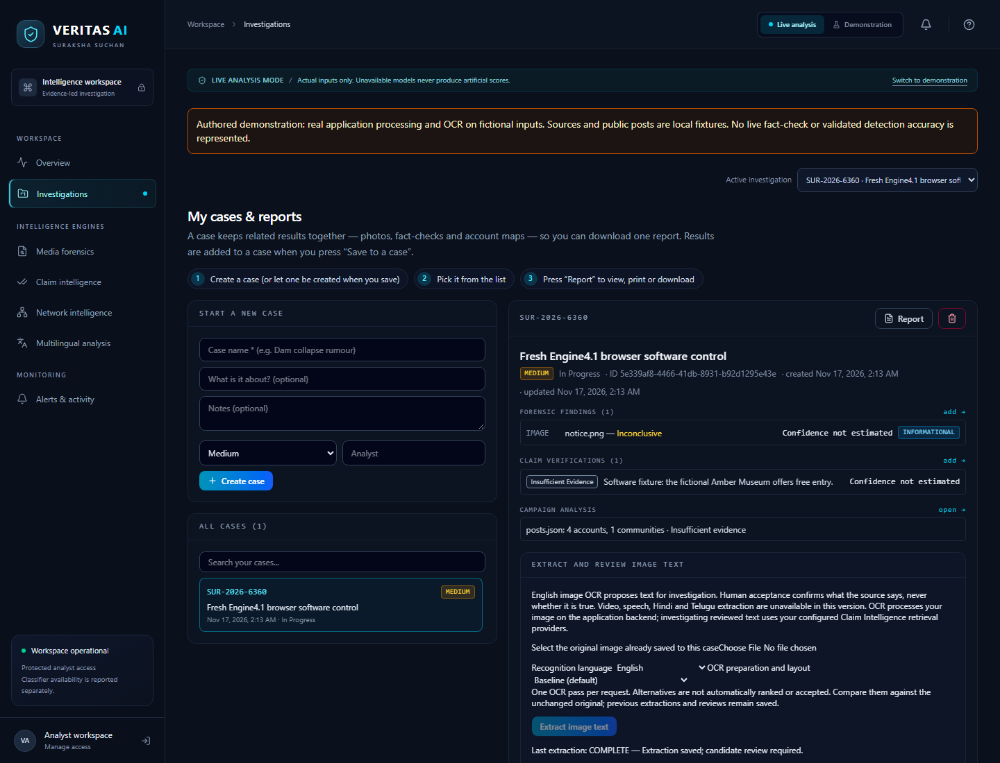
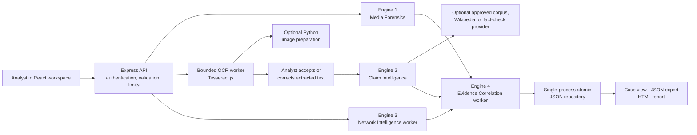

# VERITAS AI — Suraksha Suchan

**An evidence-led workspace for investigating misinformation across media, claims, public-post networks, and the relationships between them.**

A misinformation investigation rarely starts with one clean signal. An analyst may receive a suspicious image, a disputed statement, and a burst of near-identical posts—each answering a different question and carrying different uncertainty. VERITAS keeps those observations separate, preserves their provenance, requires review where automation is not trustworthy, and brings accepted evidence into one case and report.

Unlike a single “real or fake” score, VERITAS exposes the evidence trail: submitted-byte hashes, forensic measurements, exact source passages, analyst decisions, post witnesses, temporal episodes, and deterministic cross-engine links. Unavailable services remain unavailable; experimental model outputs do not silently become verdicts.

**[Run the verified local demonstration](docs/DEMO_SETUP.md)** · **[Follow the judge’s quick tour](#judges-quick-tour)** · **[Inspect the verification ledger](docs/FINAL_VERIFICATION.md)** · **[Review capability boundaries](docs/HACKATHON_READINESS.md)**



> This is a genuine screenshot of the application processing the repository’s fictional submission fixtures. It is not a real-world fact-check or proof of detector accuracy. There is **no verified public deployment**; the demonstrated path runs locally.

## At a glance

| Engine | Purpose | Implemented evidence | Deliberate boundary |
|---|---|---|---|
| **1 · Media Forensics** | Inspect submitted images, audio, and short video | Original-input identity, browser signals, provenance state, bounded frame/audio evidence, optional experimental classifiers | No validated universal deepfake verdict or calibrated authenticity probability |
| **2 · Claim Intelligence** | Turn a reviewed assertion into traceable source research | Claim selection, optional Wikipedia/corpus retrieval, exact quotations, citation provenance, analyst review, experimental reranking/NLI | Retrieval is not truth; the evaluated NLI model failed validation |
| **3 · Network Intelligence** | Describe relationships and episodes in uploaded public posts | Original post witnesses, shared text/URLs, timing, clusters, recurrence and coverage disclosures | Similarity and timing do not prove coordination or malicious intent |
| **4 · Evidence Correlation** | Connect accepted case evidence without erasing uncertainty | Deterministic case graph, attributed relationships, timeline, JSON export and HTML report | No automatic misinformation, causality, or campaign verdict |

### Evidence flow

1. An analyst creates a case and submits media, a claim, or a bounded post dataset.
2. Engines 1–3 produce independent, signed evidence records with status, provenance, and limitations.
3. OCR-derived text and source stance enter the case only after explicit analyst review; corrections remain traceable.
4. Engine 4 projects the current case into deterministic relationships. It preserves inconclusive results, conflicting sources, partial coverage, and failed or stale runs.
5. The same saved investigation drives the case view, JSON export, and HTML report.

## Architecture



This reflects the implemented process boundaries. There is no graph database, automatic truth engine, durable job queue, or multiwriter datastore. The optional full Python service supplies media evidence; the judged OCR workflow uses the smaller preparation-only service. See the [architecture notes](docs/ARCHITECTURE.md), [model contract](docs/MODEL_CONTRACT.md), and [deployment boundaries](docs/DEPLOYMENT.md).

## Judge’s Quick Tour

The shortest verified route takes about 10 minutes after prerequisites are installed. It uses actual application APIs, OCR, review gates, network analysis, correlation, persistence, and reporting with clearly disclosed fictional fixtures.

### 1. Start the reproducible demonstration

Prerequisites: Git, **Node.js 24** (declared minimum 22.12), npm, and **CPython 3.13**. The verified host used Windows; hosted CI also exercised Windows and Ubuntu.

```powershell
git clone --branch codex/integrate-figma-upgrade https://github.com/CyberShieldTeam/Deepfakedet.git
cd Deepfakedet
npm ci
py -3.13 -m venv .venv-demo
.\.venv-demo\Scripts\python.exe -m pip install -r ai_service/requirements-demo-lock.txt
.\.venv-demo\Scripts\python.exe -m ai_service.download_ocr
npm run demo
```

The explicit download is one pinned 4,113,088-byte English OCR data file; the downloader checks its size, blob, and SHA-256 and refuses to overwrite it. `npm run demo` starts loopback-only preparation and application processes, creates a fresh isolated store, and prints an ephemeral access token. It does not reset existing investigations or use personal API keys.

Linux/macOS equivalent (not verified on the recorded Windows host):

```sh
python3.13 -m venv .venv-demo
.venv-demo/bin/python -m pip install -r ai_service/requirements-demo-lock.txt
.venv-demo/bin/python -m ai_service.download_ocr
npm run demo
```

### 2. Follow one investigation end to end

Use the detailed [demo setup and recovery guide](docs/DEMO_SETUP.md) or this compact route:

1. Sign in with the ephemeral token and confirm the orange banner identifies an **authored demonstration**.
2. Open **Media Forensics**, upload [`fixtures/submission/notice.png`](fixtures/submission/notice.png), inspect the inconclusive media result, and save it to the case.
3. In the case, run **Extract and review image text**. Compare OCR with the unchanged source image, then explicitly accept or correct the assertion.
4. Open **Claim Intelligence**. Retrieve the hash-approved fictional corpus passage, inspect the exact quote and context, record an attributed review, and save it.
5. Open **Network Intelligence** and upload [`fixtures/submission/posts.json`](fixtures/submission/posts.json). Inspect original post witnesses, grouping reasons, time episodes, and coverage warnings before saving.
6. Return to **My cases & reports**, generate correlation, inspect a relationship’s supporting path, then open the report and export JSON/HTML.

For a repeatable automated acceptance run after installing Chromium, use:

```powershell
npx playwright install chromium
npm run demo:check -- --port 3337 --python-port 8417
```

The acceptance check signs in through the real UI and verifies OCR → review → source retrieval → post upload → correlation → API/disk/report parity against a fresh store. It is an engineering workflow test, not an ML accuracy benchmark.

## Example investigation: fictional museum notice

All inputs below are **fictional, authored software fixtures**. They demonstrate evidence handling, not a real event or independent fact-check.

| Stage | What happens | Evidence retained |
|---|---|---|
| **Input** | An analyst uploads `notice.png`, which states that the fictional Amber Museum offers free entry, plus an authored set of public posts | Original input identity, server receipt, hashes, timestamps, fixture provenance |
| **Media processing** | Engine 1 records image measurements and an inconclusive result; English OCR proposes text | Media observations remain separate from OCR; no authenticity score is invented |
| **Analyst review** | The analyst compares the proposed text with the source image and accepts or corrects the claim wording | Immutable raw OCR, source/display boxes, correction history, reviewer, time, rationale |
| **Claim research** | Engine 2 retrieves an authored, hash-approved local passage; the analyst reviews exact quote and context | Source title/URL, passage, content hash, review stance and citation path |
| **Network analysis** | Engine 3 processes the authored post file and exposes accounts, repeated content/URLs, witnesses, episodes, and coverage | Original post IDs/text/times and human-readable relationship reasons |
| **Correlation** | Engine 4 connects media context, the reviewed assertion, source evidence, and literal post mentions | Deterministic nodes/edges with supporting paths; inconclusive and conflicting states preserved |
| **Final report** | The application renders the stored case as an HTML report and downloadable JSON | API, stored investigation, graph, and report are checked for parity |

The verified workflow artifact contains 47 nodes, 101 relationships, and 25 cross-engine links for its authored control case. Those counts describe one deterministic software fixture; they are **not** performance or accuracy metrics. See the [Engine 4 validation record](docs/ENGINE4_VALIDATION.md) and [`reports/engine4_workflow_verified.json`](reports/engine4_workflow_verified.json).

## Capability status

| Status | Capability | What that means in this repository |
|---|---|---|
| **Implemented** | Authenticated cases, input receipts/hashes, browser media measurements, post graph/episodes, deterministic correlation, atomic single-process storage, JSON/HTML reports | Exercised by unit, API, failure-recovery, and browser workflow tests |
| **Implemented with review gate** | English image OCR, claim selection, exact-passage review, OCR correction history | Automation proposes evidence; the analyst must accept or correct it before downstream use |
| **Optional** | Full Python media service, C2PA/EXIF inspection, AASIST, image/face models, Wikipedia or approved-corpus retrieval, Google Fact Check, Gemini explanations | Requires explicit local configuration, dependencies, assets, credentials, or network access; absence is reported |
| **Experimental** | Deepfake/image classifiers, temporal measurements, AASIST scores, multilingual embeddings, NLI suggestions, MS MARCO reranking | Raw or diagnostic output only; disabled or quarantined where validation gates were not met |
| **Simulated** | Submission notice, local source corpus, public posts, seeded/demo investigations and alert story | Clearly marked fictional fixtures processed by real application workflows |
| **Unavailable / not claimed** | Validated universal deepfake accuracy, automatic factual truth, automatic malicious-coordination proof, native-script OCR validation, public deployment, Docker deployment, production-scale multiwriter storage | No substitute result or URL is fabricated |

## Technology stack

| Layer | Technology and role |
|---|---|
| Frontend | React 19, TypeScript, Vite 8, Tailwind CSS, Recharts, Lucide, Motion |
| Application API | Node.js 22.12+, Express 4, Zod validation, server-sent events |
| Workers | Bounded Node worker processes for OCR, network analysis, NLI research, and correlation |
| OCR and preparation | Tesseract.js 7 with pinned English data; optional FastAPI/Pillow preparation service |
| Optional media research | Python, OpenCV, PyTorch/Transformers, AASIST, C2PA SDK, FFmpeg-dependent video/audio paths |
| Persistence and reports | Owner-scoped, atomic single-process JSON repository; deterministic JSON and escaped HTML exports |
| Verification | Node/TypeScript tests, Python `unittest`, Supertest, Playwright, GitHub Actions |

## Installation and operating modes

### Node-only development

```sh
npm ci
npm run dev
```

Open [http://localhost:3000](http://localhost:3000). No `.env`, Python, model weights, or API key is required to start. Cases, browser measurements, network analysis, correlation, and reports work; unconfigured OCR, retrieval, and classifier services report unavailable states. Development binds to loopback by default.

### Production-like local run

```sh
npm run build
npm run demo -- --production
```

For an operator-managed server, copy [`.env.example`](.env.example), configure random 32+ character user tokens, exact origin, protected persistent storage, TLS termination, and only the optional providers you intend to use. Then run `NODE_ENV=production npm start`. Keep development dependencies installed because runtime currently uses `tsx` and imports Vite.

Static hosting and `npm run preview` do not serve the API. `docker-compose.yml` is historical and references a missing Dockerfile, so Docker is **not supported**. Do not expose the unauthenticated Python service publicly. See [deployment boundaries](docs/DEPLOYMENT.md) and [security guidance](SECURITY.md).

Key configuration groups are documented in [`.env.example`](.env.example):

- `PORT`, `VERITAS_HOST`, `VERITAS_PUBLIC_ORIGIN`, `VERITAS_USERS`, `VERITAS_STORE`
- `VERITAS_OCR_PREPARATION_URL`, `VERITAS_AI_SERVICE_URL`
- `VERITAS_CLAIM_CORPUS`, `VERITAS_CLAIM_CORPUS_SHA256`, `VERITAS_WIKIPEDIA_ENABLED`
- optional `GOOGLE_FACT_CHECK_API_KEY`, `APP_GEMINI_API_KEY`, and model/provider flags

## Testing and evaluation

### Engineering verification

The repository verifies software behavior, evidence integrity, and failure boundaries—not universal model accuracy.

| Area | Recorded result | Evidence |
|---|---|---|
| Reproducible submission demo | Real UI sign-in and OCR → review → corpus → posts → correlation → report passed in development and production-like modes | [Final verification](docs/FINAL_VERIFICATION.md), [demo setup](docs/DEMO_SETUP.md) |
| Core APIs and evidence integrity | Authentication, ownership, validation, signed attachments, atomic rollback, hashes, review revisions, failure retention, and report parity passed | [Core capability verification](docs/CORE_CAPABILITY_VERIFICATION.md) |
| Engine 1 integration | Image, audio, and video transport and evidence contracts passed; optional model absence and inconclusive states preserved | [Engine 1 verification](docs/ENGINE1_FINAL_VERIFICATION.md) |
| Engine 2 integration | Retrieval, citations, selection, review, persistence, report propagation, and research-provider failure handling passed | [Engine 2 verification](docs/ENGINE2_FINAL_VERIFICATION.md), [advanced validation](docs/ENGINE2_ADVANCED_VALIDATION.md) |
| Engine 3 integration | Upload, API, worker, UI, case, and report boundaries and bounded failure recovery passed | [Engine 3 verification](docs/ENGINE3_VERIFICATION.md) |
| Engine 4 integration | Deterministic graph, scope isolation, caps, stale-run recovery, and API/disk/report equality passed | [Engine 4 validation](docs/ENGINE4_VALIDATION.md) |
| OCR controls | Authored OCR/review controls passed; independent dataset coverage was insufficient for a release accuracy claim | [OCR validation](docs/ENGINE42_VALIDATION.md), [release limits](docs/ENGINE43_VALIDATION.md) |

Run the principal documentation and application checks:

```sh
npm run docs:check
npm run lint
npm run build
npm run test:startup
npm test
npm run test:engine3
npm run test:engine4
npm run test:diagnostics
npm run test:extraction
npm run test:engine42
```

Some optional runtime tests require the corresponding Python service, model asset, corpus, or browser installation. A setup-gated skip is not counted as a pass in the linked ledgers.

### Independent ML accuracy: not established

- The admitted media fixtures are smoke and integration material, not a representative deepfake benchmark. Deepfake detector accuracy remains unvalidated; raw model outputs are not calibrated probabilities. See [model evaluation](docs/IMAGE_MODEL_EVALUATION.md) and [dataset readiness](EVALUATION_DATASETS.md).
- The offline English NLI checkpoint failed its predeclared external validation criteria. It remains opt-in research output and cannot create an authoritative factual verdict. See [NLI evaluation](docs/ENGINE2_NLI_EVALUATION.md).
- The optional reranker improved ordering in a recorded example and has small relevance experiments, but remains experimental and cannot verify truth. See [reranker evaluation](docs/ENGINE2_RERANKER_EVALUATION.md).
- OCR has authored controls and bounded independent experiments, but no completed rights-cleared screenshot holdout, native-script accuracy result, or validated automatic profile selector. See [OCR release validation](docs/ENGINE43_VALIDATION.md).
- Engine 3 and Engine 4 have no independently labelled malicious-campaign or misinformation accuracy result. Their rules expose associations and evidence paths, not intent.

## Limitations and responsible interpretation

- **Media detection is unvalidated.** Image, face, audio, and temporal models and signals have different scopes and failure modes; none is a universal deepfake detector. Compression, capture pipeline, speech presence, motion, lighting, and domain shift can change outputs.
- **NLI validation failed.** Model suggestions are visibly separated from analyst-reviewed evidence and default workflows do not promote them to factual decisions.
- **Reranking is experimental.** A high relevance score only changes ordering; it does not establish source authority, applicability, stance, independence, or truth.
- **OCR does not generalize by assumption.** The demonstrated path is English image OCR. Hindi and Telugu, video, and speech extraction are unavailable in this version; screenshots, rotation, scale, layout, and unseen domains need independent evaluation.
- **Network evidence is descriptive.** Repeated text, shared URLs, close timing, graph density, or recurrence can occur for legitimate reporting and do not automatically prove coordination or malicious intent.
- **Correlation is deterministic, not causal.** A literal mention may quote or deny a claim; a shared URL may change; timeline order does not prove causality; analyst assertions are attributed but not independently true.
- **Optional services may be unavailable.** Models, model weights, external providers, FFmpeg capabilities, API quotas, or credentials are not bundled uniformly. Health and result states disclose the gap rather than inventing output.
- **The demo is simulated.** Its notice, sources, public posts, cases, and alert narrative are fictional. Real software processes them, but this is not independent evidence of real-world accuracy.
- **No public deployment is verified.** The supported path is local. Storage is one application process and one JSON writer; there is no object archive, durable queue, database replication, OAuth or MFA, deployment-wide quota system, or validated service-level objective.
- **Original media is not an evidence archive.** Submitted-byte identity and stored hashes support traceability for the processed input, but operators must preserve originals and chain of custody separately.
- All outputs are decision support. Consequential claims require human review, suitable primary sources, and applicable legal or organizational procedures.

## Documentation map

- **Start here:** [demo setup](docs/DEMO_SETUP.md), [architecture](docs/ARCHITECTURE.md), [final verification](docs/FINAL_VERIFICATION.md), [hackathon readiness](docs/HACKATHON_READINESS.md)
- **Media:** [model card](MODEL_CARD.md), [audio model card](AUDIO_MODEL_CARD.md), [video engine](VIDEO_ENGINE.md), [provenance and signals](docs/IMAGE_PROVENANCE_AND_SIGNALS.md)
- **Claims:** [claim workflow](docs/CLAIM_VERIFICATION.md), [source citations](docs/CLAIM_SOURCE_CITATIONS.md), [NLI evaluation](docs/ENGINE2_NLI_EVALUATION.md), [advanced validation](docs/ENGINE2_ADVANCED_VALIDATION.md)
- **Networks:** [campaign API](docs/CAMPAIGN_API.md), [episode model](docs/CAMPAIGN_EPISODES.md), [evaluation limits](docs/ENGINE3_EVALUATION.md)
- **Correlation and OCR:** [evidence model](docs/ENGINE4_EVIDENCE_MODEL.md), [Engine 4 limits](docs/ENGINE4_LIMITATIONS.md), [OCR audit](docs/ENGINE42_OCR_AUDIT.md), [OCR release limits](docs/ENGINE43_VALIDATION.md)
- **Operations:** [security](SECURITY.md), [deployment](docs/DEPLOYMENT.md), [contributing](CONTRIBUTING.md), [implementation history](IMPLEMENTATION_PROGRESS.md)

## Repository and licensing

Repository: [CyberShieldTeam/Deepfakedet](https://github.com/CyberShieldTeam/Deepfakedet), branch `codex/integrate-figma-upgrade`.

No repository-wide `LICENSE` file or verified individual team roster is present, so this README does not invent either. Third-party code, models, data, and assets retain their own terms. The authored demonstration fixture provenance is recorded in [`fixtures/submission/manifest.json`](fixtures/submission/manifest.json).
