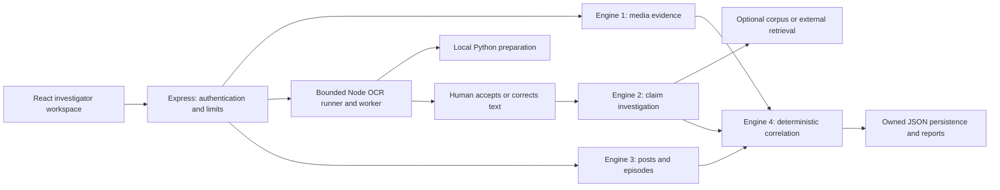

# VERITAS AI — Suraksha Suchan

An investigation workspace connecting media measurements, reviewed claims and public-post
relationships in a source-traceable evidence graph and report.

**Engineering demonstration with explicit uncertainty.** Independent deepfake detection,
screenshot OCR generalization and malicious-campaign accuracy remain unvalidated.
Missing services return unavailable states, never invented predictions.

## Problem and approach

A media anomaly, a disputed claim and a burst of similar posts answer different questions.
VERITAS keeps their evidence separate, then records how an investigator connects them:

- **Engine 1 — Media forensics:** submitted-byte hashes, browser measurements and optional
  local image/audio/video evidence. Experimental outputs stay separate from verdicts.
- **Engine 2 — Claim intelligence:** source retrieval, passages and attributed analyst review.
  Retrieval alone does not establish factual truth.
- **Engine 3 — Network intelligence:** post witnesses, shared URLs/text, temporal episodes,
  recurrence and coverage disclosures. Similarity does not establish malicious intent.
- **Engine 4 — Correlation:** case-scoped relationships, proofs, timeline, JSON export and
  HTML reports. OCR candidates require current human review before investigation.

English image OCR includes explicit rotation, experimental scaling/single-line layout,
original-coordinate boxes, immutable text and correction history. Research tooling supports
frozen manifests, bounded batches and failure accounting; it does not certify accuracy.


Actual application processing of fictional software fixtures; not a real fact-check.

## Architecture and workflow



The stack is React 19, TypeScript, Vite, Express, Zod, Tesseract.js and optional
FastAPI/Pillow/ML services. External classifiers, Gemini and embeddings are optional;
semantic embeddings remain diagnostic-only where documented. There is no graph database
or automatic truth engine. See [architecture](docs/ARCHITECTURE.md).

## Getting started

Verified host: **Windows, Node 24.19, npm 11.17, CPython 3.13**. Declared Node minimum is
22.12; use Node 24 for the tested path. Git is required. Hosted Windows and Ubuntu
CI also passed with Node 24.22.2; see [verification](docs/FINAL_VERIFICATION.md).

```sh
git clone --branch codex/integrate-figma-upgrade https://github.com/CyberShieldTeam/Deepfakedet.git
cd Deepfakedet
npm ci
npm run dev
```

Open [localhost:3000](http://localhost:3000). Development binds loopback by default;
set `VERITAS_HOST` explicitly if you intend to expose a protected listener. Node-only startup needs no `.env`, Python or
API keys. It provides cases, measurements, network analysis, correlation and reports;
unconfigured source retrieval/classifiers/OCR remain unavailable. The initial synthetic
case view is labelled. Uploaded inputs use the real API.

For the **complete OCR demonstration**, install the small preparation environment.
Windows PowerShell (use the Windows launcher rather than an unrelated MSYS Python):

```powershell
py -3.13 -m venv .venv-demo
.\.venv-demo\Scripts\python.exe -m pip install -r ai_service/requirements-demo-lock.txt
.\.venv-demo\Scripts\python.exe -m ai_service.download_ocr
npm run demo
```

This explicitly downloads one pinned **4,113,088-byte English OCR file**, verifies
size/blob/SHA-256 and refuses overwrites. Demo runtime never downloads models. No PyTorch,
large detector or private key is required. Processing uses local OCR and authored local
evidence; cosmetic external fonts are not required.

The launcher starts preparation and Express on loopback, creates a fresh isolated store
and prints an ephemeral token. Enter it in the access dialog. Follow
[the demo steps](docs/DEMO_SETUP.md); existing investigations are never reset.

Linux/macOS equivalent Python setup (not executed on this Windows host):

```sh
python3.13 -m venv .venv-demo
.venv-demo/bin/python -m pip install -r ai_service/requirements-demo-lock.txt
.venv-demo/bin/python -m ai_service.download_ocr
npm run demo
```

## Configuration and production-like startup

Normal startup loads an optional repository-root `.env`; [`.env.example`](.env.example)
documents settings. The isolated demo overrides providers/storage and never uses personal
API keys or the default case store.

| Setting | Purpose |
|---|---|
| `PORT`, `VERITAS_HOST` | HTTP listener; demo binds `127.0.0.1` |
| `VERITAS_USERS` | Random >=32-character tokens mapped to owner IDs; never commit credentials |
| `VERITAS_PUBLIC_ORIGIN` | Exact public origin for a protected deployment |
| `VERITAS_STORE` | Protected JSON store; default `data/investigations.json` |
| `VERITAS_OCR_PREPARATION_URL` | Optional preparation-only URL; falls back to `VERITAS_AI_SERVICE_URL` |
| `VERITAS_AI_SERVICE_URL` | Optional full Python media service |
| `VERITAS_CLAIM_CORPUS`, `VERITAS_CLAIM_CORPUS_SHA256` | Approved, hash-verified source corpus |
| `GOOGLE_FACT_CHECK_API_KEY` | Optional external fact-check-review retrieval |
| `APP_GEMINI_API_KEY` | Optional explanations/translation; no classifier probabilities or truth verdicts |
| `VERITAS_IMAGE_*`, `VERITAS_AUDIO_*`, `VERITAS_EMBEDDING_*` | Optional provider adapters |

```sh
npm run build
npm run demo -- --production
```

For an actual server, configure credentials, TLS and persistent storage, set
`NODE_ENV=production`, then `npm start`. Keep dev dependencies: runtime currently uses
`tsx` and imports Vite. Static-only hosting and `npm run preview` cannot serve the API.
See [deployment limits](docs/DEPLOYMENT.md). No public deployment is claimed. The historical
Compose template lacks a Dockerfile and is explicitly unsupported.

## Tests and engineering validation

```sh
npm run lint
npm run build
npm run test:startup
npm test
npm run test:engine3
npm run test:engine4
npm run test:diagnostics
npm run test:extraction
npm run test:engine42
npm run docs:check
npx playwright install chromium
npm run demo:check -- --port 3337 --python-port 8417
npm run demo:check -- --production --port 3338 --python-port 8418
```

Demo acceptance signs in through the real UI, uploads the image, runs OCR, records review,
retrieves the fictional source, uploads posts through the UI, correlates and checks
API/disk/report parity. Each run gets a fresh store. Generic browser setup-gated skips
are not passes. [Verification](docs/FINAL_VERIFICATION.md) lists Python checks and actual
results. CI requires no private API keys; full Python checks install dependencies but no
model weights.

Source hashes, review revisions, ownership, deterministic graph construction, failure
retention, report consistency and worker recovery have regression tests. Authored control
scores are not independent research. Screenshot/native-script accuracy, detection
calibration and malicious-campaign ground truth remain open. No automatic OCR selector
is enabled.

JSON persistence supports **one application process**, not multiple writers/replicas.
Original media is not archived. Token authentication is not OAuth/MFA; sessions are lost
on restart. Broad load tests, deployment-wide quotas and an encrypted evidence archive
remain work. See [readiness](docs/HACKATHON_READINESS.md) and [security](SECURITY.md).

## Documentation, attribution and license

- [Demo setup/recovery](docs/DEMO_SETUP.md) and [recording guide](docs/DEMO_VIDEO_SCRIPT.md)
- [Architecture](docs/ARCHITECTURE.md), [deployment](docs/DEPLOYMENT.md), [verification](docs/FINAL_VERIFICATION.md)
- [Implementation history](IMPLEMENTATION_PROGRESS.md), [model card](MODEL_CARD.md),
  [audio model card](AUDIO_MODEL_CARD.md), [video engine](VIDEO_ENGINE.md)
- [Engine 4.3 boundaries](docs/ENGINE43_VALIDATION.md) and [contributing](CONTRIBUTING.md)

Repository: CyberShieldTeam/Deepfakedet. No individual team roster is verified here.
No repository-wide license file is present; this update does not invent an open-source
license. Third-party assets/models retain their terms. Authored demo provenance is in
[the fixture manifest](fixtures/submission/manifest.json). The video guide is a script,
not a claim that a recording exists.
