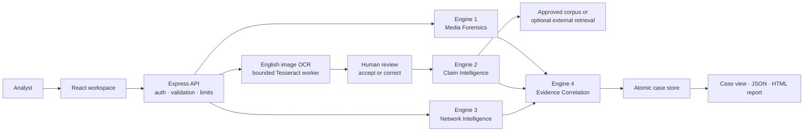

# VERITAS AI — Suraksha Suchan

VERITAS is an investigation workspace for misinformation incidents. It helps an analyst examine suspicious media, research a claim, inspect how related posts spread, and connect the evidence in one case.

Most tools answer only one part of that problem: a detector scores a file, a fact-checker reviews a sentence, or a graph tool groups accounts. VERITAS keeps those findings separate until an analyst has reviewed them, then records exactly how they are connected. The result is an inspectable evidence trail—not a single “fake” score.

[Run the local demo](#run-the-demo) · [Take the judge’s tour](#judges-quick-tour) · [Read the verification ledger](docs/FINAL_VERIFICATION.md) · [See known limitations](#limitations)


<sub>Actual VERITAS application screenshot from the authored demo. The museum notice, sources, and posts are fictional fixtures; the OCR, APIs, review flow, graph construction, persistence, and report generation are real application paths.</sub>

## What we built

VERITAS combines four implemented engines around a shared investigation record:

| Engine | Question it helps answer | What it produces |
|---|---|---|
| **1. Media Forensics** | What can we measure about this image, audio clip, or short video? | File identity, browser-computed signals, provenance state, frame/audio observations, and optional experimental model output |
| **2. Claim Intelligence** | What exactly is being claimed, and what do the available sources say? | Reviewed claim text, retrieved passages, citations, source-review history, and optional relevance/NLI research output |
| **3. Network Intelligence** | Which posts share text, URLs, timing, or recurring activity? | Original post witnesses, explainable links, account clusters, episodes, recurrence, and coverage disclosures |
| **4. Evidence Correlation** | How does the accepted evidence in this case relate? | A deterministic case graph, supporting paths, an uncertainty-aware timeline, JSON export, and HTML report |

This separation matters. A suspicious image does not prove its caption is false; repeated posts do not prove malicious coordination; a relevant source does not automatically support a claim. VERITAS preserves those distinctions instead of hiding them behind one confidence percentage.

## How an investigation flows



The diagram mirrors the current implementation: React and TypeScript in the browser; an Express API; bounded workers for OCR, network analysis, research inference, and correlation; optional Python media/preparation services; and a single-process JSON repository. There is no graph database, automatic truth engine, or multiwriter backend. More detail is in [Architecture and evidence boundaries](docs/ARCHITECTURE.md).

## Key implemented capabilities

- **Evidence identity:** server-issued receipts, input hashes, model/source identities, timestamps, and review revisions survive case attachment and reporting.
- **Media inspection:** image ELA/frequency measurements, metadata and C2PA states, video frame/temporal observations, audio measurements, and optional local model adapters are reported independently.
- **Review-gated OCR:** English text extraction retains the original OCR, geometry, corrections, reviewer, time, and rationale. Unreviewed text cannot silently become a claim.
- **Traceable claim research:** local approved corpora and opt-in Wikipedia retrieval return exact passages and clickable source/revision references. Source applicability and stance remain analyst decisions.
- **Explainable network analysis:** every graph link is backed by observed text, URL, timing, or episode evidence. Original posts and coverage limitations remain available for inspection.
- **Deterministic correlation:** Engine 4 connects only case-scoped evidence using documented rules, preserves conflicting and incomplete evidence, and produces stable relationship IDs.
- **Failure-safe persistence:** atomic writes, rollback tests, stale-run markers, ownership checks, bounded workers, and escaped reports protect the evidence already stored.

## Judge’s Quick Tour

After setup, the complete authored workflow takes a few minutes:

1. Start the demo and sign in with the ephemeral token printed in the terminal.
2. Open **Media Forensics** and upload [`fixtures/submission/notice.png`](fixtures/submission/notice.png). Inspect the measurements and save the inconclusive result.
3. Open the case, run **Extract and review image text**, compare the OCR with the source image, and accept or correct the proposed claim.
4. In **Claim Intelligence**, retrieve the hash-approved fixture passage. Review the exact quotation and its context before saving it.
5. In **Network Intelligence**, upload [`fixtures/submission/posts.json`](fixtures/submission/posts.json). Inspect the original posts, link reasons, groups, and activity episodes.
6. Return to the case, generate **Evidence Correlation**, inspect a relationship’s supporting path, and open the final report.

The checked workflow uses the normal UI and APIs—not a separate presentation screen or hardcoded verdict.

## Verified walkthrough: the Amber Museum fixture

The repository includes a fictional notice stating that the fictional Amber Museum offers free entry. It is paired with an authored source corpus and authored public posts. These inputs exist solely to make the whole investigation reproducible.

| Step | Application behavior | Evidence preserved |
|---|---|---|
| Upload | Engine 1 processes `notice.png` and returns an inconclusive media result | Submitted-byte identity, receipt, measurements, and processing status |
| Extract | The OCR worker proposes English text from the image | Raw text, word boxes, source/display coordinates, model identity, and image hash |
| Review | The analyst checks the source image and accepts or corrects the claim | Immutable original OCR plus revision, reviewer, time, and rationale |
| Research | Engine 2 retrieves the approved fictional passage | Corpus hash, title, URL, exact quote, context, and attributed stance review |
| Map spread | Engine 3 processes the authored posts | Original IDs, text, timestamps, links, clusters, episodes, and coverage notes |
| Correlate | Engine 4 connects the reviewed claim with its media, source, and literal post mentions | Deterministic nodes, edges, and supporting paths without a misinformation verdict |
| Report | The case is exported through the report API and UI | API, stored investigation, graph export, and rendered report parity |

One recorded Engine 4 control case contains **47 nodes, 101 relationships, and 25 cross-engine links**. These are fixture graph counts, not accuracy or scale claims. The full record is in [Engine 4 validation](docs/ENGINE4_VALIDATION.md) and [`reports/engine4_workflow_verified.json`](reports/engine4_workflow_verified.json).

## Run the demo

### Prerequisites

- Git
- Node.js 24 and npm (the package declares Node.js 22.12 or newer)
- CPython 3.13 for the OCR preparation service

The recorded clean setup used Windows. The project’s GitHub Actions workflow also exercised the core/demo path on Windows and Ubuntu. macOS has not been verified.

### Windows PowerShell

```powershell
git clone https://github.com/CyberShieldTeam/Deepfakedet.git
cd Deepfakedet
npm ci
py -3.13 -m venv .venv-demo
.\.venv-demo\Scripts\python.exe -m pip install -r ai_service/requirements-demo-lock.txt
.\.venv-demo\Scripts\python.exe -m ai_service.download_ocr
npm run demo
```

### Linux/macOS equivalent

```sh
git clone https://github.com/CyberShieldTeam/Deepfakedet.git
cd Deepfakedet
npm ci
python3.13 -m venv .venv-demo
.venv-demo/bin/python -m pip install -r ai_service/requirements-demo-lock.txt
.venv-demo/bin/python -m ai_service.download_ocr
npm run demo
```

The downloader installs one pinned 4,113,088-byte English OCR data file and verifies its size, blob identity, and SHA-256. The demo launcher binds both services to loopback, creates a fresh isolated case store, disables unrelated external providers, and prints a temporary access token. It does not reset the normal investigation store.

See [Demo setup and recovery](docs/DEMO_SETUP.md) for ports, production-like mode, troubleshooting, and cleanup.

### Node-only development

```sh
npm ci
npm run dev
```

Open [http://localhost:3000](http://localhost:3000). The app starts without Python, model weights, or API keys. Core case, browser-measurement, network, correlation, and reporting paths remain available; unconfigured OCR, retrieval, and classifier services report an unavailable state.

For a production-like local run:

```sh
npm run build
npm run demo -- --production
```

Static-only hosting and `npm run preview` do not serve the API. The historical `docker-compose.yml` references a missing Dockerfile and is not a supported installation path. A real deployment also needs TLS, protected persistent storage, secrets management, and the controls described in [Deployment boundaries](docs/DEPLOYMENT.md) and [Security](SECURITY.md).

## Technology stack

| Layer | Technologies |
|---|---|
| Web application | React 19, TypeScript, Vite 8, Tailwind CSS, Recharts, Lucide, Motion |
| API and validation | Node.js, Express 4, Zod, server-sent events |
| Analysis workers | Node worker processes for OCR, network analysis, correlation, and optional research inference |
| OCR | Tesseract.js 7 with pinned English data; FastAPI/Pillow preparation endpoint |
| Optional media services | Python, OpenCV, PyTorch/Transformers, AASIST, C2PA SDK, FFmpeg paths |
| Storage and reports | Owner-scoped atomic JSON repository, JSON export, escaped HTML report |
| Testing | Node assertions, Python `unittest`, Supertest, Playwright, GitHub Actions |

## Testing and technical evidence

Engineering tests and scientific evaluation answer different questions. A passing API or browser test shows that evidence moves through the system correctly; it does not establish detector accuracy.

### Reproducibility and software verification

| Check | Recorded result | Evidence |
|---|---|---|
| Clean authored demo | Development and production-like browser workflows passed: sign-in, upload, real OCR, review, retrieval, post import, correlation, persistence, and report parity | [Final verification](docs/FINAL_VERIFICATION.md) |
| Hosted CI | Windows and Ubuntu application jobs passed the core/demo workflow; the separate full-Python job reported 95 passes and three absent-asset skips | [GitHub Actions run 43953655764](https://github.com/CyberShieldTeam/Deepfakedet/actions/runs/43953655764) |
| Engine 1 | Input identity, media transport, optional-model failure states, persistence, and reporting passed; final local ledger records 118 Python tests with no skips | [Engine 1 final verification](docs/ENGINE1_FINAL_VERIFICATION.md) |
| Engine 2 | Claim selection, retrieval, citations, review history, optional worker controls, persistence, and reporting passed | [Engine 2 final verification](docs/ENGINE2_FINAL_VERIFICATION.md) |
| Engine 3 | Upload-to-worker-to-UI-to-report boundaries, caps, busy/timeout handling, and recovery passed | [Engine 3 verification](docs/ENGINE3_VERIFICATION.md) |
| Engine 4 | Determinism, scope isolation, caps, stale-run recovery, and API/store/report equality passed | [Engine 4 validation](docs/ENGINE4_VALIDATION.md) |

Run the principal repository checks with:

```sh
npm run docs:check
npm run lint
npm run build
npm run test:startup
npm test
npm run test:engine3
npm run test:engine4
npm run test:diagnostics
npm run test:extraction
npm run test:engine42
```

Optional live-model, OCR-runtime, and browser suites need their documented services or assets. A setup-gated skip is not counted as a pass.

### Model and evaluation results

| Evaluation | Actual result | Decision |
|---|---|---|
| Image/audio/video models | The available media sets are small integration or research samples. Image candidates did not clear every validation gate; AASIST showed severe genuine false positives; no trained temporal detector was validated | Keep media models experimental and authenticity results inconclusive. [Engine 1 evaluation](docs/ENGINE1_FINAL_VERIFICATION.md) |
| English NLI on held-out ANLI (300 pairs) | 32.33% three-class accuracy, macro-F1 .3184; accepted predictions were 27.27% accurate | Failed every promotion gate; the worker remains opt-in research output. [NLI evaluation](docs/ENGINE2_NLI_EVALUATION.md) |
| Relevance reranking on held-out SciFact (30 queries) | MRR .5722 → .5944 and nDCG@6 .5959 → .6125; Recall@6 unchanged at .6833. The development split regressed | Optional experimental ordering only; it does not infer stance or truth. [Reranker evaluation](docs/ENGINE2_RERANKER_EVALUATION.md) |
| OCR | Authored controls and bounded independent experiments exist, but no completed rights-cleared screenshot holdout or native-script accuracy study exists | English image OCR stays review-gated; no automatic profile selector is enabled. [OCR validation](docs/ENGINE43_VALIDATION.md) |
| Network/correlation | Rule, API, resource, and authored workflow controls passed; the independent campaign evaluator admitted zero campaigns | No precision/recall or malicious-intent claim. [Engine 3 evaluation](docs/ENGINE3_EVALUATION.md) |

## Capability status

| Status | Included capabilities |
|---|---|
| **Implemented** | Authenticated cases; evidence receipts and hashes; browser media measurements; English OCR and review history; approved-corpus retrieval; post graphs and episodes; deterministic correlation; JSON/HTML reports |
| **Optional** | Full Python media service; C2PA/EXIF inspection; AASIST; image/face models; Wikipedia, Google Fact Check, Gemini explanation/translation, embeddings, NLI, and reranking providers |
| **Experimental** | Media classifiers, temporal signals, AASIST scores, semantic diagnostics, NLI suggestions, and relevance reranking |
| **Simulated for the demo** | The Amber Museum notice, source corpus, public posts, initial cases, and alert narrative |
| **Not available or not claimed** | Validated universal deepfake detection, automatic truth verification, proof of malicious coordination, Hindi/Telugu OCR, speech/video transcription, public deployment, Docker deployment, or multiwriter storage |

## Limitations

- **Deepfake accuracy is not validated.** The media adapters expose measurements and research scores, not a dependable universal detector or calibrated authenticity probability.
- **The NLI model failed validation.** Its suggestions cannot create an authoritative factual verdict. Human-reviewed source evidence remains decisive.
- **Reranking is experimental.** It can reorder existing English passages, but relevance is not support, source authority, or truth.
- **OCR scope is narrow.** The demonstrated path is English text in images. Hindi/Telugu OCR, speech transcription, video text extraction, and cross-domain accuracy remain unvalidated or unavailable.
- **Network patterns are not intent.** Similar text, shared URLs, timing, density, and recurrence can arise from legitimate reporting. VERITAS does not automatically prove coordination or malicious behavior.
- **Correlation is not causation.** A post may quote or deny a claim; an analyst caption is attributed context, not independent truth; timeline order does not establish causality.
- **Optional services can be absent.** Model files, external APIs, credentials, quotas, or system codecs are not guaranteed. Missing dependencies produce explicit unavailable or failed states.
- **The demo inputs are fictional.** They demonstrate the real workflow, not real-world fact-checking accuracy.
- **Deployment remains local and single-process.** There is no verified public URL, multiwriter database, object archive, durable queue, OAuth/MFA, or measured service-level objective.
- **VERITAS is decision support.** High-impact conclusions still require qualified human review, appropriate primary sources, and a separately maintained chain of custody for original media.

## Documentation and references

| Topic | Documents |
|---|---|
| Start and operate | [Demo setup](docs/DEMO_SETUP.md) · [Architecture](docs/ARCHITECTURE.md) · [Deployment](docs/DEPLOYMENT.md) · [Security](SECURITY.md) |
| Media | [Model card](MODEL_CARD.md) · [Audio model card](AUDIO_MODEL_CARD.md) · [Video engine](VIDEO_ENGINE.md) · [Image provenance and signals](docs/IMAGE_PROVENANCE_AND_SIGNALS.md) |
| Claims | [Claim workflow](docs/CLAIM_VERIFICATION.md) · [Source citations](docs/CLAIM_SOURCE_CITATIONS.md) · [NLI evaluation](docs/ENGINE2_NLI_EVALUATION.md) · [Reranker evaluation](docs/ENGINE2_RERANKER_EVALUATION.md) |
| Networks | [Campaign API](docs/CAMPAIGN_API.md) · [Episodes](docs/CAMPAIGN_EPISODES.md) · [Engine 3 evaluation](docs/ENGINE3_EVALUATION.md) |
| Correlation and OCR | [Evidence model](docs/ENGINE4_EVIDENCE_MODEL.md) · [Engine 4 limits](docs/ENGINE4_LIMITATIONS.md) · [OCR audit](docs/ENGINE42_OCR_AUDIT.md) · [OCR release validation](docs/ENGINE43_VALIDATION.md) |
| Project evidence | [Final verification](docs/FINAL_VERIFICATION.md) · [Dataset readiness](EVALUATION_DATASETS.md) · [Implementation history](IMPLEMENTATION_PROGRESS.md) · [Contributing](CONTRIBUTING.md) |

## License and attribution

No repository-wide `LICENSE` file or verified individual team roster is currently present, so this README does not assign one. Third-party code, models, data, and assets retain their own terms. Provenance for the authored demo assets is recorded in [`fixtures/submission/manifest.json`](fixtures/submission/manifest.json).
